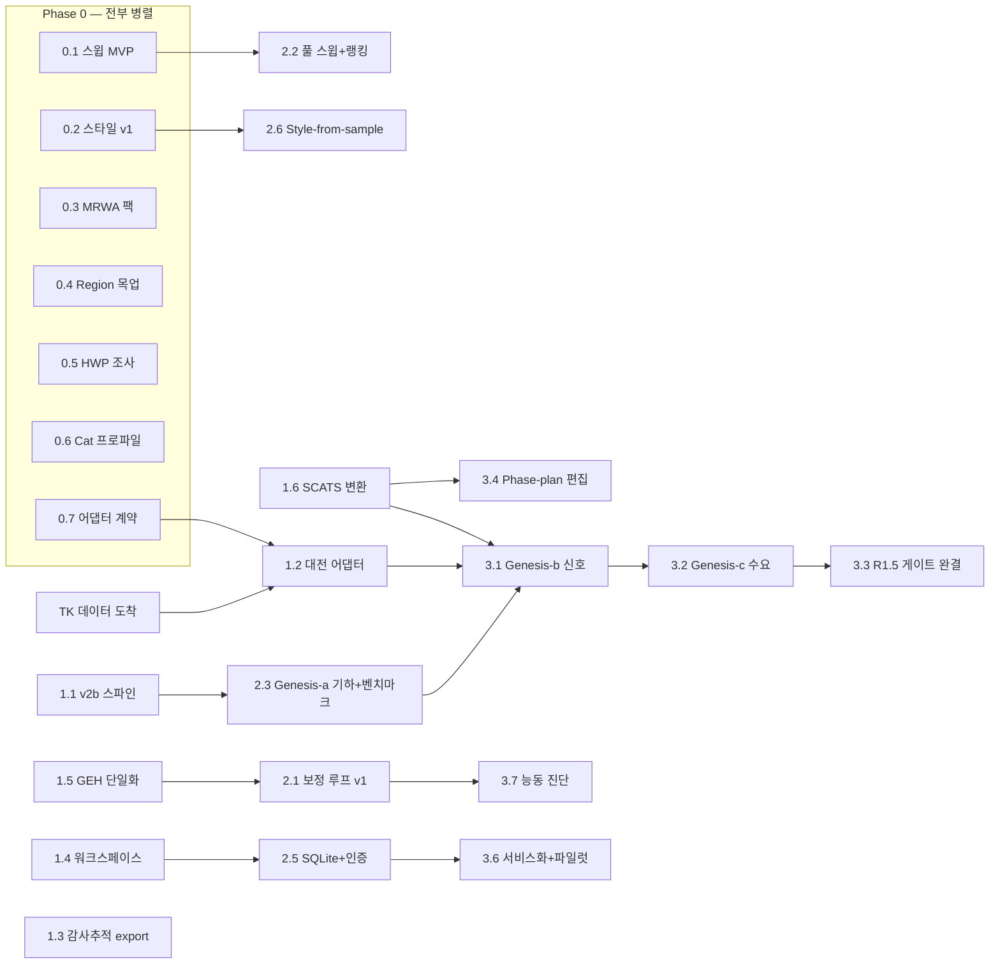

# Prism Master Roadmap — 통합판 (2026-07-31)

**One document, everything.** Integrates: TK 요구사항 v2.1 (EPIC 1–5), 기존 ROADMAP.md의 제품
로드맵(구매동인 기능·배포 사다리·플랫폼 업그레이드), TOOL-CATALOG v2b/v2c 잔여 티어,
UX 백로그 26건, 그리고 이번 주까지 출하된 모든 기반. 논문은 보류(계측은 계속 축적).

---

## 1. 북극성 (Vision)

**컨설턴트의 전체 파이프라인을 하나의 제품으로:**

```
Scoping ─→ Data ─→ Build ─→ Calibrate ─→ Analyze ─→ Report
(범위/기준)  (수집/검증) (AI 생성)  (AI 보정루프)  (스윕/결론)  (스타일 자동)
```

오늘의 Prism은 Build 이후의 **편집·검증**에 강함(37개 도구, 90개 제약, 승인·롤백·배치,
GEH 대시보드). 로드맵의 무게중심은 **왼쪽으로 확장**(Genesis·Data)과 **오른쪽 완성**
(Calibrate 루프·Analyze 결론·Report 스타일), 그리고 이를 **팀 제품으로 만드는 바닥**
(워크스페이스·인증·배포)이다.

원칙: ① 한국/대전 먼저, 어댑터로 세계화 ② micro 먼저 ③ 검증 계층이 곧 제품 — AI가 만들고
AI가 거부한다 ④ 벽 먼저, 탑은 그 위에(v2b 없이 genesis 없음) ⑤ 매주 데모 가능한 가치.

---

## 2. 워크스트림 (8 tracks)

병렬화의 단위. 트랙끼리는 **파일·도메인이 거의 겹치지 않게** 설계했다 — 이번 주 내내
검증된 실행 방식(컨트롤러 + Sonnet 유닛, 파일셋 격리)이 그대로 적용된다.

| Track | 이름 | 주 파일 영역 | 내용물 |
|---|---|---|---|
| **G** | Network Genesis | `services/genesis/`(신설), v2b XML-build | EPIC 1: region UI, 기하 생성, 신호/수요 시딩, R1.5 게이트, Murdoch 벤치마크 |
| **D** | Data Adapters | `services/import/`(신설) | 어댑터 계약, 대전 어댑터, SCATS 어댑터+고정시간 변환(R1.3b), 데이터 품질 게이트(R2.5), TOPIS/공공데이터 |
| **C** | Calibration & Validation | `services/agent/` 일부, validation | EPIC 2: anomaly 카탈로그→fix 루프→reality check, MRWA 제약/디폴트 팩, Cat 1/2/3 프로파일, GEH 단일화(UX#2) |
| **S** | Scenario Intelligence | `services/agent/` sweep, jobs | EPIC 3: 수요 스트레스, 시나리오 매트릭스(N안×M수요×≥5시드), 랭킹+결론, 비교 워크플로 |
| **R** | Reporting | report exports, `services/report/` | EPIC 4: 데이터 추출, 스타일 프리셋, 감사추적(변경이력) export, style-from-sample, HWP 조사 |
| **P** | Platform & Deploy | routers, state, db(신설) | 워크스페이스→SQLite→로그인/역할→서비스화+TLS 단일 오리진→보존정책→전용 워커, 공유 링크, 데이터 경계 문구 |
| **X** | Experience & Viz | frontend 전반 | region 선택 목업, network diff view, 리플레이 업그레이드(.lsa 신호재생·차량추적·큐 하이라이트), 라이브 렌더링, 3D/위성, 온보딩, UX 백로그 26건 |
| **A** | Agent Core | `services/agent/` | EPIC 5 phase-plan 편집, RBC/VAP 파일 편집(COM 불가 판명분), 능동 진단, RAG 코퍼스, v2c 잔여 |

**트랙 간 충돌 주의 2곳:** C와 S와 A는 모두 `services/agent/`를 만진다 → 같은 시기에 이 셋
중 **둘만** 활성화(유닛 파일셋으로 세분 격리). X의 NetworkViewer 유닛은 항상 직렬.

---

## 3. Phase 계획

### Phase 0 — "이번 주" (지금 착수 가능, 전부 병렬-안전)

의존성 0, 파일셋 상호 배타, 데이터 대기 불필요.
**상태 표기(전 문서 공통): ✅ 완료 · 🔄 진행 중 · ⬜ 대기. 유닛이 끝날 때마다 이 문서의
해당 행을 갱신한다(운영 규칙, 2026-07-31).**

| # | 상태 | 항목 | Track | 왜 지금 |
|---|---|---|---|---|
| 0.1 | 🔄 | **스윕 MVP** (+N% 수요, ≥5시드 고정, 시드 시나리오 간 동일, 평균 보고, 델타 리포트) — task #33 | S | TK의 "+10%" 질문에 그대로 답함; §5 런 규율 스펙 확보됨 |
| 0.2 | 🔄 | **리포트 데이터 추출 + 그림 스타일 v1** (회사 프리셋) — task #34 | R | 저위험 즉시 가치 |
| 0.3 | ⬜ | **MRWA 제약/디폴트 팩** — Table 5-9/5-10 gap 범위·5-6 safety distance·5-8 RSA 속도를 경고 참조로, §5 디폴트를 데이터 파일로 | C | 숫자 전부 확보됨; 기존 90-제약 구조에 얹기만 |
| 0.4 | ✅ | **Region 선택 UX 목업** (v1 발행: docs/product/mockups/region-selection-mockup.html) (폴리곤 라쏘 + 도로 단위 토글, 제외 시각화) | X | 사용자 디자인 주도권; genesis UI의 계약을 먼저 정의 |
| 0.5 | ⬜ | **HWP 도구 생태 조사 보고서** (pyhwp/hwpx/Hancom COM — 가능/비용/추천) | R | 에스컬레이션 규칙 1회차; 보고서 포맷 우선순위 결정 자료 |
| 0.6 | ⬜ | **Cat 1/2/3 검증 프로파일** (Table 5-12/13/14를 드롭다운으로; Cat1은 이미 일치 확인) | C | 수치 확보됨; 대시보드 확장만 |
| 0.7 | ⬜ | **어댑터 계약 초안** (controller/program/phase/detector/count 중립 스키마 — 문서+Pydantic) | D | 대전 파일 도착 전에 계약을 먼저; 도착 즉시 어댑터 착수 가능 |

Exit: 스윕 데모 가능, 스타일된 리포트 1장, MRWA 인용 경고 실동작, 목업 TK 송부.

### Phase 1 — Foundation (주 1–3)

| # | 항목 | Track | 의존 |
|---|---|---|---|
| 1.1 | **v2b 스파인**: XML-build+reparse+참조무결성 기계 → lane closure → 측정 인프라 배치(queue counter/travel-time section 자동) → full link closure | G | 없음 (가장 긴 벽 — 최우선 착수) |
| 1.2 | **대전 어댑터 v1** (신호+카운트 → 중립 스키마 → 기존 신호/입력 모델) + R2.5 데이터 품질 게이트 | D | TK 파일 (0.7 계약 선행) |
| 1.3 | **감사추적 export v1** — 액션 레저 → "파라미터 변경 기록+근거" 섹션 (DOCX; 승인 시 사유 1줄 입력) | R | 없음 |
| 1.4 | **프로젝트 워크스페이스** (P②: 전역 활성 데이터셋 싱글톤 제거 — 접근통제 경계) | P | 없음 |
| 1.5 | **GEH 파이프라인 단일화** (UX#2: 3개 구현 → 1개 백엔드 유틸) + UX 백로그 high 잔여(#7 방향별 지연, #24 단위) | C/X | 없음 |
| 1.6 | **SCATS→고정시간 변환 모듈** (R1.3b — 가중평균 phase/demand frequency; §5+LinSig 장 수식, 부록 A 도착 시 보강) | D | 없음(수식 확보) |

Exit: v2b로 "링크 폐쇄"가 승인·검증·롤백을 통과, 대전 데이터가 중립 스키마로 읽힘,
변경이력 DOCX가 실제 레저에서 생성됨, 업로드가 워크스페이스에 격리됨.

### Phase 2 — Intelligence (주 3–7)

| # | 항목 | Track | 의존 |
|---|---|---|---|
| 2.1 | **보정 루프 v1**: anomaly 카탈로그(유령 대기열·차단 커넥터·기아 링크·diffusion/latent>1%) → fix 매핑 → 승인 루프 → **reality check**(관측 데이터 대조, R2.3) | C | 1.5, 관측 데이터 스토어 |
| 2.2 | **풀 스윕 + 랭킹 결론** (대안 열거 → 매트릭스 실행 → KPI 랭킹 → 분석 트레일 포함 결론) | S | 0.1 |
| 2.3 | **Genesis (a) 기하 생성**: OSM → 링크/커넥터/차로 초안(§5 코딩 관행 준수) + **Murdoch 재구축 벤치마크 파이프라인**(R1.6 — 구조 diff 리포트) | G | 1.1 |
| 2.4 | **Network diff view** (두 버전 나란히, 변경 하이라이트 — MRWA Model Audit View 사상) | X | 없음(artifact 버전 존재) |
| 2.5 | **SQLite 메타데이터 + 로그인/역할** (P③④: WAL, 파일은 파일로; modeler/reviewer/admin을 승인 게이트에 바인딩) | P | 1.4 |
| 2.6 | **Style-from-sample v1** (DOCX 팔레트/폰트/로고/헤딩 추출 → 리포트 적용) | R | 0.2 |
| 2.7 | **온보딩** (샘플 프로젝트 번들 + 가이드 투어) + 데이터 경계 문구 | X | 1.4 |

Exit: 보정 루프가 실제 anomaly 1종을 자동 수정하고 1종을 "실제 행동"으로 올바르게 거부,
Murdoch 벤치마크 diff 리포트 v1 존재, 리뷰어가 로그인해 승인 이력을 자기 이름으로 남김.

### Phase 3 — Genesis 완성 (주 7–12)

| # | 항목 | Track | 의존 |
|---|---|---|---|
| 3.1 | **Genesis (b) 신호**: 대전 어댑터+R1.3b → 컨트롤러/프로그램 생성, signal head/detector 자동 배치(§5 기본값 2.0m/4.5m) | G | 2.3, 1.2, 1.6 |
| 3.2 | **Genesis (c) 수요**: 카운트 → vehicle inputs(15분 프로파일)+compositions+routing 시딩 | G | 3.1 |
| 3.3 | **Genesis (d) R1.5 검증 게이트 완결** (V1–V9 전체 자동 실행 — genesis의 출하 게이트) | G | 3.2 |
| 3.4 | **EPIC 5 phase-plan 편집** (phase 추가/삭제/시퀀스, intergreen 검증; VAP 구조는 §5.4.2.5 참조) | A | 1.6 |
| 3.5 | **리플레이 업그레이드** (.lsa 신호 재생, 차량 추적, 큐 하이라이트) + 라이브 스텝-스트리밍 | X | 없음 |
| 3.6 | **배포 서비스화** (Windows 서비스 + 단일 오리진 TLS + 보존정책/디스크 모니터) — 파일럿 준비 | P | 2.5 |
| 3.7 | **능동 진단** (요청 없이 gridlock/anomaly 플래그 — 2.1의 카탈로그 재사용) | A | 2.1 |

Exit: **대전 데이터 기반 소규모 실지역을 지도에서 생성 → 게이트 통과 → 시뮬레이션 →
리포트까지 원 파이프라인 데모.** 파일럿 서버 1대 가동.

### Phase 4 — Scale & Convergence (주 12+)

- **E2E 파일럿**: 외부 컨설턴트 1팀 실사용 (P⑤ 클라우드 뷰어 검토)
- **어댑터 2호: WA SCATS 완결** + 어댑터 SDK 문서화(서드파티 포맷 추가 가능하게)
- **v2c 잔여**: 캘리브레이션 파라미터 탐색(GEH-scored), ODME, 시나리오 매니지먼트(.trax)
- **3D/위성 뷰**, RAG 코퍼스 완성
- **meso 재평가** (수요 있으면 — meso 파라미터는 conflict-area 속성이라 연속성 있음)
- **제품 통합 탐색** (Nexus/Vista 경계 — 궁극 목표)
- **논문**: 축적된 계측(스윕/보정 루프 텔레메트리 + 액션 로그)으로 TR-C 집필 — 미국행 이후

---

## 4. 병렬화 지도 — 무엇을 동시에 돌릴 수 있나

**실행 모델** (이번 주 검증된 방식 그대로): 컨트롤러(Fable) + Sonnet 유닛, 유닛당 명시적
파일셋, 컨트롤러가 독립 재검증 후 커밋. 야간엔 직렬 큐(COM 검증 유닛), 주간엔 병렬 2–3
유닛(파일셋 격리분).

**동시 실행 규칙:**

1. **상시 3레인**: ① 백엔드 agent/COM 레인(내부 직렬 — 같은 파일 무리 + Vissim 라이선스
   1개 가정) ② 프론트/UX 레인(NetworkViewer 유닛은 그 안에서 직렬) ③ 플랫폼 또는
   리포트 레인. 여기에 ④ **사용자 레인**(목업 디자인, TK 데이터/부록/라이선스 추격)이 항상
   병행.
2. **Phase 0의 7항목은 전부 동시 가능** — 파일셋: S(sweep)=agent/sweep 신설, R(styling)=report,
   C(팩)=constraints 데이터 파일, X(목업)=디자인 산출물, R(HWP)=조사 문서, C(프로파일)=
   validation 프론트, D(계약)=신규 문서/스키마. 유일한 겹침 후보는 0.3과 0.6(둘 다 C) —
   파일이 다르므로(백엔드 제약 vs 프론트 대시보드) 안전.
3. **Phase 1: 1.1 ∥ 1.2 ∥ 1.3 ∥ 1.4 전부 병렬 가능.** 1.5는 1.3과 리포트 영역이 스치므로
   순서 조정. 1.6은 순수 신규 모듈이라 아무 때나.
4. **긴 벽(1.1 v2b)은 조기 착수가 전부다** — genesis 3개 마일스톤(2.3→3.1→3.2→3.3)이 전부
   이 위에 선다. 다른 어떤 것도 이 벽을 기다리지 않게 설계했다(보정·스윕·리포트·플랫폼은
   벽과 무관).
5. **COM 직렬 제약**: 라이선스 수 확인 전까지 live-COM 검증이 필요한 유닛은 하루 1큐(야간).
   라이선스가 N개로 판명되면 스윕 병렬도와 COM 유닛 병렬도가 함께 풀린다 — **질문 3의
   답이 로드맵 속도를 직접 바꾼다.**
6. **데이터 게이트**: 1.2(대전 어댑터)만 TK 파일에 묶임. 그래서 0.7(계약)을 먼저 빼서
   도착 즉시 착수 가능하게 했다. 부록 A/B는 1.6 보강과 포화류 제약에만 영향 — 블로커 아님.

**의존 그래프 (요약):**



---

## 5. 리스크 레지스터

| 리스크 | 영향 | 완화 |
|---|---|---|
| Vissim 라이선스 1개/약관상 자동화 제한 | 스윕·COM 병렬도 상한, 서버 실행 적법성 | **서면 확인 최우선**(기존 ROADMAP의 질문 그대로: node-locked/floating, 서버측 실행 허용, COM 포함 여부); 폴백 = 엔지니어 PC 워커 |
| OSM 차로수/기하 정확도 | Genesis-a 품질 | 항공사진 보정 워크플로 + R1.6 벤치마크로 오차 정량화; "초안+게이트" 포지셔닝 |
| TK 데이터 지연 | 1.2→3.1 지연 | 0.7 계약 선행; SCATS 변환은 수식으로 선개발; 대전 공공데이터 API로 임시 샘플 검토 |
| HWP 생성 비용 폭탄 | R4.3 한국 시장성 | 0.5 조사 후 **사용자 결정** (에스컬레이션 규칙) |
| `services/agent/` 트랙 충돌 (C/S/A) | 유닛 리워크 | 동시 2트랙 상한 + 유닛 파일셋 명시 (이번 주 방식) |
| 단일 Windows 박스 자원 | 스윕이 UI를 굶김 | 워커 추상화(P 트랙)를 배포 전 선행 — 기존 ROADMAP 결론 유지 |
| 디스크 (5시드 600s = 44MB/run) | 파일럿 장애 | 보존정책+모니터를 3.6에 내장 (기존 ROADMAP 결론 유지) |
| 미국행 인수인계 | 연속성 | 매 유닛 DECISIONS 기록(이미 관행) + Phase 3 종료 시 운영 문서화 스프린트 |

## 6. 오늘 시작할 것 (결정 요청)

Phase 0의 7항목은 모두 착수 가능. 추천 첫 배치(병렬 3 + 사용자 1):
- **0.1 스윕 MVP** (백엔드 레인) + **0.2 리포트 스타일 v1** (리포트 레인) + **0.3 MRWA 팩**
  (제약 데이터 레인) → Sonnet 유닛 3개 동시
- **0.4 Region 목업** → 사용자(디자인) — 초안 와이어는 우리가 만들어 드릴 수도 있음
- 이어서 0.5/0.6/0.7을 다음 배치로.
