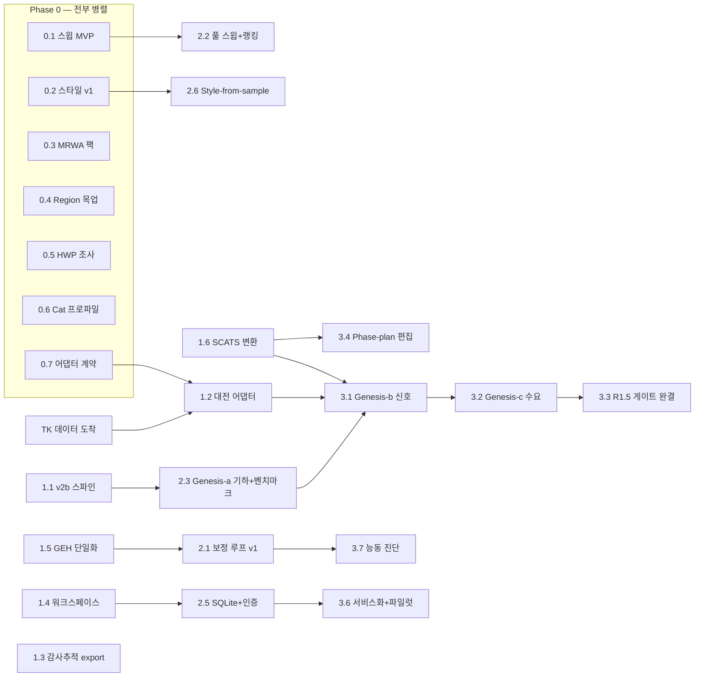

# Prism Master Roadmap — 통합판 (2026-07-31)

**One document, everything.** Integrates: TK 요구사항 v2.1 (EPIC 1–5), 기존 ROADMAP.md의 제품
로드맵(구매동인 기능·배포 사다리·플랫폼 업그레이드), TOOL-CATALOG v2b/v2c 잔여 티어,
UX 백로그 26건, 그리고 이번 주까지 출하된 모든 기반. 논문은 보류(계측은 계속 축적).

---

## 1. 북극성 (Vision)

**컨설턴트의 전체 파이프라인을 하나의 제품으로:**

```
Scoping ─→ Data ─→ Build ─→ Calibrate ─→ Analyze ─→ Report
(범위/기준)  (수집/검증) (AI 생성)  (AI 보정루프)  (스윕/결론)  (스타일 자동)
```

오늘의 Prism은 Build 이후의 **편집·검증**에 강함(37개 도구, 90개 제약, 승인·롤백·배치,
GEH 대시보드). 로드맵의 무게중심은 **왼쪽으로 확장**(Genesis·Data)과 **오른쪽 완성**
(Calibrate 루프·Analyze 결론·Report 스타일), 그리고 이를 **팀 제품으로 만드는 바닥**
(워크스페이스·인증·배포)이다.

원칙: ① 한국/대전 먼저, 어댑터로 세계화 ② micro 먼저 ③ 검증 계층이 곧 제품 — AI가 만들고
AI가 거부한다 ④ 벽 먼저, 탑은 그 위에(v2b 없이 genesis 없음) ⑤ 매주 데모 가능한 가치.

---

## 2. 워크스트림 (8 tracks)

병렬화의 단위. 트랙끼리는 **파일·도메인이 거의 겹치지 않게** 설계했다 — 이번 주 내내
검증된 실행 방식(컨트롤러 + Sonnet 유닛, 파일셋 격리)이 그대로 적용된다.

| Track | 이름 | 주 파일 영역 | 내용물 |
|---|---|---|---|
| **G** | Network Genesis | `services/genesis/`(신설), v2b XML-build | EPIC 1: region UI, 기하 생성, 신호/수요 시딩, R1.5 게이트, Murdoch 벤치마크 |
| **D** | Data Adapters | `services/import/`(신설) | 어댑터 계약, 대전 어댑터, SCATS 어댑터+고정시간 변환(R1.3b), 데이터 품질 게이트(R2.5), TOPIS/공공데이터 |
| **C** | Calibration & Validation | `services/agent/` 일부, validation | EPIC 2: anomaly 카탈로그→fix 루프→reality check, MRWA 제약/디폴트 팩, Cat 1/2/3 프로파일, GEH 단일화(UX#2) |
| **S** | Scenario Intelligence | `services/agent/` sweep, jobs | EPIC 3: 수요 스트레스, 시나리오 매트릭스(N안×M수요×≥5시드), 랭킹+결론, 비교 워크플로 |
| **R** | Reporting | report exports, `services/report/` | EPIC 4: 데이터 추출, 스타일 프리셋, 감사추적(변경이력) export, style-from-sample, HWP 조사 |
| **P** | Platform & Deploy | routers, state, db(신설) | 워크스페이스→SQLite→로그인/역할→서비스화+TLS 단일 오리진→보존정책→전용 워커, 공유 링크, 데이터 경계 문구 |
| **X** | Experience & Viz | frontend 전반 | region 선택 목업, network diff view, 리플레이 업그레이드(.lsa 신호재생·차량추적·큐 하이라이트), 라이브 렌더링, 3D/위성, 온보딩, UX 백로그 26건 |
| **A** | Agent Core | `services/agent/` | EPIC 5 phase-plan 편집, RBC/VAP 파일 편집(COM 불가 판명분), 능동 진단, RAG 코퍼스, v2c 잔여 |

**트랙 간 충돌 주의 2곳:** C와 S와 A는 모두 `services/agent/`를 만진다 → 같은 시기에 이 셋
중 **둘만** 활성화(유닛 파일셋으로 세분 격리). X의 NetworkViewer 유닛은 항상 직렬.

---

## 3. Phase 계획

### Phase 0 — "이번 주" (지금 착수 가능, 전부 병렬-안전)

의존성 0, 파일셋 상호 배타, 데이터 대기 불필요.
**상태 표기(전 문서 공통): ✅ 완료 · 🔄 진행 중 · ⬜ 대기. 유닛이 끝날 때마다 이 문서의
해당 행을 갱신한다(운영 규칙, 2026-07-31).**

| # | 상태 | 항목 | Track | 왜 지금 |
|---|---|---|---|---|
| 0.1 | ✅ | **스윕 MVP** (+N% 수요, ≥5시드 고정, 시드 시나리오 간 동일, 평균 보고, 델타 리포트) — task #33 | S | TK의 "+10%" 질문에 그대로 답함; §5 런 규율 스펙 확보됨 |
| 0.2 | ✅ | **리포트 데이터 추출 + 그림 스타일 v1** (회사 프리셋) — task #34 | R | 저위험 즉시 가치 |
| 0.3 | ✅ | **MRWA 제약/디폴트 팩** — Table 5-9/5-10 gap 범위·5-6 safety distance·5-8 RSA 속도를 경고 참조로, §5 디폴트를 데이터 파일로 | C | 숫자 전부 확보됨; 기존 90-제약 구조에 얹기만 |
| 0.4 | ✅ | **Region 선택 UX 목업** (v1 발행: docs/product/mockups/region-selection-mockup.html) (폴리곤 라쏘 + 도로 단위 토글, 제외 시각화) | X | 사용자 디자인 주도권; genesis UI의 계약을 먼저 정의 |
| 0.5 | ✅ | **HWP 도구 생태 조사 보고서** (pyhwp/hwpx/Hancom COM — 가능/비용/추천) | R | 에스컬레이션 규칙 1회차; 보고서 포맷 우선순위 결정 자료 |
| 0.6 | ✅ | **Cat 1/2/3 검증 프로파일** (Table 5-12/13/14를 드롭다운으로; Cat1은 이미 일치 확인) | C | 수치 확보됨; 대시보드 확장만 |
| 0.7 | ✅ | **어댑터 계약 초안** (controller/program/phase/detector/count 중립 스키마 — 문서+Pydantic) | D | 대전 파일 도착 전에 계약을 먼저; 도착 즉시 어댑터 착수 가능 |

Exit: 스윕 데모 가능, 스타일된 리포트 1장, MRWA 인용 경고 실동작, 목업 TK 송부.

### Phase 1 — Foundation (주 1–3) — ✅ **전 유닛 완료 2026-08-05**

| # | 상태 | 항목 | Track | 의존 |
|---|---|---|---|---|
| 1.1 | ✅ | (주말 Q4로 대부분 완료) **v2b 스파인 + 10/13 불릿**: 스파인(inpx_structure.py) + lane/link closure·turn bans·측정 인프라·signal heads/detectors·links/connectors 생성·stop signs/priority rules·PT stops/lines — **composite ✅ 2026-08-03 (Q5 ①: 전 스테이지 green, 프로세스 경계 검증 + 합성 증명)**, **signal controller 생성 ✅ 2026-08-03 (Q5 ②: `add_signal_controller`, duplicate-then-edit 4번째; genesis 갭 ② 종료)**, **vehicle input 생성 ✅ 2026-08-03 (Q5 ③: `add_vehicle_input` + 커넥터/인터벌 warn 2건 + 반쯤 배선된 10개 동사 `object_not_found` 배선 완결; genesis 갭 리스트 전체 종료)**; **link geometry edits ✅ 2026-08-03 (Q6 ①: lane count/centreline·points·curvature 3동사 + refuse/warn 3건, registry 107)**, **parking lots ✅ 2026-08-04 (Q6 ②: representation-first 3동사 + 리더, registry 110)**, **pedestrian inputs ✅ 2026-08-04 (Q6 ③: input 3동사 + 리더, static-routing 게이트 실측, registry 113)** — **1.1 전체 완료 (v2b 카탈로그 잔여 불릿 0)** | G | — |
| 1.2 | ✅ | (카운트측 완료 2026-08-05, 33eed3e — 어댑터+`class_total_consistency` 게이트+demand 시딩(R1.4 카운트측); 실드롭 11개 워크북 0 REFUSE; 신호측은 TK 기계가독 export 답변 대기로 열림) **대전 어댑터 v1** (신호+카운트 → 중립 스키마 → 기존 신호/입력 모델) + R2.5 데이터 품질 게이트 | D | TK 파일 ✅ 도착·인벤토리 완료 2026-08-03 (0f4026d): 카운트측 즉시 착수 가능(U턴 포함 회전교통량·6종 차종·15분·5주); 신호측은 PDF 23건 — TK에 기계가독 export 문의 필요 |
| 1.3 | ✅ | (2026-08-05, c40ee0d — DOCX export(ko/en/ja) + `/summary` + 승인 사유 1줄 백엔드; 승인 카드의 사유 입력·다운로드 버튼은 UX 백로그로) **감사추적 export v1** — 액션 레저 → "파라미터 변경 기록+근거" 섹션 (DOCX; 승인 시 사유 1줄 입력) | R | 없음 |
| 1.4 | ✅ | (2026-08-05, 56f7f5c — runtime/workspaces/&lt;id&gt;/uploads/ + X-Workspace-Id 스코핑, 세션 소유권 fail-closed, 업로드 트랜잭션화(스테이지→프로모트)·zip-bomb·413·캐시 무효화; 런/세션 트리는 논리 격리만 — 물리 이전은 P③. 알려진 구멍 2건(websocket, health &lt;a href&gt;)은 DECISIONS 기록) **프로젝트 워크스페이스** (P②: 전역 활성 데이터셋 싱글톤 제거 — 접근통제 경계) | P | 없음 |
| 1.5 | ✅ | (2026-08-05, 7cfe8eb — 실측 4개 구현(문서상 3개)→런타임당 1개 + `shared/geh-conformance.json` 교차언어 고정; 미정의 GEH는 분모에서 제외되어 **고객 리포트 수치가 내려감**(AM 합계 80%→67%) — 근거·전후표는 DECISIONS; #7은 실측 VEHDELAY 가중평균으로 대체(미측정은 데이터 없음), #24는 대·시 환산 완료. #28은 별건으로 유지) **GEH 파이프라인 단일화** (UX#2: 3개 구현 → 1개 백엔드 유틸) + UX 백로그 high 잔여(#7 방향별 지연, #24 단위) | C/X | 없음 |
| 1.6 | ✅ | (2026-08-05, d42e401 — A.2 가중평균+A.3 클리어런스+A.5 오프셋 전체, 인용 상수 기계 대조; LinSig 항목·yellow-trap은 측정상 불가로 제외, DECISIONS 참조) **SCATS→고정시간 변환 모듈** (R1.3b — 가중평균 phase/demand frequency; 부록 A 수령·정독 완료(2026-07-31) — 알고리즘 명세 확보: docs/product/reference/mrwa-appendix-a-extract.md) | D | 없음(수식 확보) |

Exit: v2b로 "링크 폐쇄"가 승인·검증·롤백을 통과, 대전 데이터가 중립 스키마로 읽힘,
변경이력 DOCX가 실제 레저에서 생성됨, 업로드가 워크스페이스에 격리됨.

### Phase 2 — Intelligence (주 3–7)

실행 계획(2026-08-05 수립, 10-에이전트 스카우트/설계/심사 워크플로): Exit 문장이 곧 채점표이므로
**2.1 · 2.3 · 2.5가 필수 3종**, 나머지 4행은 Phase 2에서 제외(2.4는 U2 산출물을 그대로 소비하므로
미루면 오히려 싸짐). 유닛 순서: U1 런 증거 → U2 Murdoch diff → U3 anomaly 카탈로그 → U4 fix 매핑
→ U4a 합성 카운트 픽스처 → U5 reality check + 수정/거부 한 쌍 → U6 런 레지스트리 원자성 →
U7 auth 코어 → U8 승인 기록에 actor → U9 로그인 UI. 이후 U10 관측 스토어+대전 ingest, U11 링크
평가 arming(기아 링크), 그다음 2.3의 OSM 생성기와 P③ 전체.

| # | 상태 | 항목 | Track | 의존 |
|---|---|---|---|---|
| 2.1 | ✅ | **보정 루프 v1**: anomaly 카탈로그(유령 대기열·차단 커넥터·기아 링크·diffusion/latent>1%) → fix 매핑 → 승인 루프 → **reality check**(관측 데이터 대조, R2.3) — U1 ✅ 2026-08-05 `76aa8de`(죽어 있던 postrun 제약 3건을 실제 증거로 기동: 0→3, + `results_evidence.py` 3-상태 서술자), U3 ✅ 2026-08-06 `3216076`(카탈로그: 4개 anomaly 5-상태, 커버리지 파생·뮤테이션 증명), U4 ✅ `3dfd26b`+`f0ea0be`(3-갈래 fix 매핑; 검증이 라우팅 배율 10배 오류를 적발 — decision_movements 스코프 필수, 없으면 거부), U4a ✅ `7d96c6e`(합성 카운트 워크북, GEH 설계값 문서화, 바이트 안정), U5 ✅ `363aab6`(reality check + run_reality_check read-tool: 실행 대 관측, 조인 전량 공개; **exit 시연 오프라인 완결 — 수요 제안 1건 + 거부 1건**, 승인 게이트까지 COM 제로). **승인 루프 데모 ✅ 2026-08-06 `test_calibration_loop_e2e.py`** — 제안→승인 일시정지→인증된 리뷰어 승인(근거=제안 rationale)→적용→DOCX에 승인자·GEH 근거·거부 부재까지 한 문서로 증명, COM 제로. **Exit 절 1 완결.** **U10 ✅ 2026-08-06 `6df70c4`**(관측 스토어: 거부 우선 스트리밍 ingest 24.3MB 피크, 기간 필수, 23:45 소견 보존, site↔node 조인은 호출자 매핑·전량 공개) — **행 전체 완료**. 후속(별도): 승인 카드에 rationale 필드(플래너 다중 모듈 수술), 데이터 창 자동 정렬. **거부 형태 사용자 승인 완료 2026-08-06: 볼륨/GEH 기반**("노드 총량이 GEH<5로 관측과 합치 → 수요 오류가 아니라 회전 배분 문제, 모델이 실제 거동을 재현 중" — 관측 대기열/지체는 대전 드롭에 없고 스키마에도 자리가 없어 큐 기반 거부는 불가, 리뷰어 기대치도 이 형태로 맞출 것) | C | 1.5 ✅, 관측 데이터 스토어(U10) |
| 2.2 | ⬜ | **풀 스윕 + 랭킹 결론** (대안 열거 → 매트릭스 실행 → KPI 랭킹 → 분석 트레일 포함 결론) — Phase 2 범위에서 제외 | S | 0.1 ✅ |
| 2.3 | ✅ | **Genesis (a) 기하 생성**: OSM → 링크/커넥터/차로 초안(§5 코딩 관행 준수) + **Murdoch 재구축 벤치마크 파이프라인**(R1.6 — 구조 diff 리포트) — **벤치마크 절반 ✅ 2026-08-05 `2db6343`**(위상만, 위치는 원천 거부: 유일한 georeference가 잔차 ~14 m·척도항 1.1782 = Web-Mercator 위도 왜곡 → 차로폭 4개 바닥. 실 네트워크 변이 왕복 정확 복원, 자체 뮤턴트 7종 전멸). **OSM 생성기 v1 ✅ 2026-08-06 `b07b42a`**(로컬 .osm → draft .inpx + §5 준수 리포트(적용 7/위반 1 명명/판정불가 13 사유付); 좌측통행은 우측통행 부호의 부정으로 증명; 투영 유효반경은 위도 의존 — Perth 2254 m, Vincenty 오라클 검증; U2 differ가 왕복 오라클, 결정론적 출력). **벤치마크 v1 실행 완료 2026-08-06**(실 Murdoch OSM → 2069링크 draft, §5 위반 3건 명명; diff 실행 — 한계 명명: 순차 id가 컨설턴트 id와 충돌해 id 기반 대응은 무효, v2는 위상 매칭 필요; 전체 리포트는 client-data/). **Vissim 실오픈 테스트 실행 완료 `04a2ca0`** — 결과는 가설 3건 전부 반증: 생성 .inpx 미로딩(practice.inpx가 손제작 파일이라 필수 속성 ~35개 부재 — emitter v2 수정 목록 DECISIONS), linkSegment는 Vissim이 쓰지 않는 요소(노드 소속은 기하 계산 필요 — 전 네트워크 공통 파서 가정 오류), lane index 1 = 우측(좌측통행에선 중앙분리대측). **emitter v2 ✅ 2026-08-06 `36d0f64` — 생성 네트워크가 실 Vissim에 로딩됨**(crossroads·Murdoch 2069링크 모두 LoadNet 성공, .err 0건, SaveNetAs 왕복 카운트 보존, conflict area 5,518개 자동 계산; 스키마는 Vissim-saved 참조에서 값별 출처 주석으로 채움 — 발명 0; lane index 실측 반영; 노드 소속은 기하 계산으로 전 네트워크 복구; 침묵 로딩 지뢰 2호 발견·차단 — timeDistributions 부재 시 load_ok=True에 링크 0). **벤치마크 v2 ✅ 2026-08-07 `fafd661`**(기하 대응: 22 m 허용오차는 출처 명시 — Helmert 잔차 14 + 투영 예산 1 + 차로폭 수당 7; 체인 매칭, 버킷 분할 단언, 실쌍 결과 링크 78.3% 매치 / 110 누락 사유별 / 모호 0(실증); 위치 델타는 구조적으로 금지). 부산물로 파서 회귀 적발·수정 `a522ec6`: 컨설턴트 파일은 노드를 linkSegment 선언으로 정의(139건, 폴리곤 없음) — 선언 우선 + 폴리곤 폴백으로 양 모드 지원. **연결성 레이어 ✅ 2026-08-10 `c0c0c63` — 생성 네트워크가 225곳에서 함정이었다**: 사용자가 Vissim에서 생성망을 열고 "이 끊김이 진짜냐"고 물은 데서 시작. 측정 결과 2,069개 링크 끝 중 1,844개는 정상(12 m 셋백을 커넥터가 잇고 있음)이나 225개는 진짜 단절. 원인 4종 중 우리가 생각한 것은 하나뿐이었다 — Murdoch Drive는 노드 병합 실패가 아니라 **build_draft가 MIN_LINK_LENGTH_M 미만 세그먼트를 조용히 버린 것**(58개 세그먼트, 225곳 중 40곳의 원인; 방출되지 않은 링크는 근접도 분류기가 볼 수 없음). 구현: OSM 위상 기반 막다른길 U턴(근접도 아님 — 막다른길과 실패한 교차로는 3.5 m에서 동일하게 보이나 정반대 처방이 필요), 노드 병합 7.0 m = 2 × 3.5 m 차로폭(오차 예산이 아니라 **동일성의 상한**으로 도출), 서비스도로 정책 명시(모델링·연결, --exclude-service는 옵트인이며 명명된 skip 생성), 회전제한은 이동을 제거만, 재측정용 프로브. 두 MIN_LINK_LENGTH_M 드롭은 이제 측정 길이와 실패 임계값을 담은 명명된 skip을 남긴다(병합이 58→9로 줄였을 뿐 보이게 만들지는 않았고, 독자는 부재를 알아챌 수 없다). **적대적 검증이 본 유닛 결함 11건 적발(치명 2건), 최악은 실 클라이언트 망에서 재현**: 97개 병합 클러스터 중 2개가 서로 다른 way의 고립 종단점만으로 구성 — 실제로 만나지 않는 두 도로를 교차로로 용접하고 회전 커넥터까지 부여했다. **생성기가 도로를 발명한 것.** 원인은 7.0 m의 근거("두 교차로는 한 차도보다 가까울 수 없다" — 교차로에 관한 주장)와 임의의 way 종단점을 허용한 적격 규칙의 불일치, 그리고 병합 후 막다른길 분류기가 두 종단점을 못 보게 되어 아무 보고도 없었던 점. 수정: 병합은 **원본이 이미 선언한 교차로를 조정(reconcile)** 해야 하며(병합쌍의 최소 한 노드가 2개 이상 way에 참조), 종단점↔종단점 병합은 금지·명명 거부; 등급분리 거부는 쌍 단위→**클러스터 단위**(합법적 지상/교량 전이 노드가 등급 간 가교가 되어 지역도로를 고가도로에 얹을 수 있었음 — 모듈 docstring이 명명한 바로 그 위험). 두 번째 치명: 21곳 중 8곳이 생성기에 전혀 보이지 않고 프로브 자체 휴리스틱으로만 분류·명명되어 어떤 준수 리포트에도 없었다 → 이제 생성기가 21건 전수 census를 소유하고 프로브는 그것을 읽는다. **결과 225 → 21**(수리 불가 일방통행 막다른길 15 · 전 이동이 U턴인 교차로 4 · 정상 모델 경계 2), 발명된 교차로 2 → 0, 출력 바이트 동일, emit.py 무수정, 전체 스위트 4003 통과. **오프라인 한정 — LoadNet 미실행**: 156개 3.50 m 역평행 U턴 적재·경로, node_id 0→실 노드 id로 옮긴 U턴, 병합 2개 감소가 dangling fromLinkEndPt를 남기지 않는지는 라이브만 증명 가능. **행 완료.** 남은 후속은 3.1(신호)·3.2(수요)의 몫 | G | 1.1 ✅ |
| 2.4 | ✅ | **Network diff view** — 2026-08-07 `4b7be78`: /api/network/diff + /network-diff 페이지. 토큰 공간은 실측 설계(1,572 세션 중 edit 버전 2개 이상 = 0개 → 스냅샷 4종: 0/edit_NNN/working/active); 소유권은 기존 공유 헬퍼; 위치는 payload 그대로 카운트+불확실성 밴드(측정 아님 명기, doesNotMatch 핀 4개로 부패 경로 차단). 미해결 상류 갭 명시: DiffFinding.messages는 아무도 채우지 않음 — 채워지는 날 페이지가 자동 우선 사용 | X | 없음 ✅ |
| 2.5 | 🔄 | **SQLite 메타데이터 + 로그인/역할** (P③④) — **로그인/역할 완료 2026-08-06**: U6 `d5d3507`(런 레지스트리 원자화+파손 공개), U7 `146ef91`(auth 코어: SQLite WAL users/auth_sessions, scrypt, CLI 부트스트랩·기본 자격증명 없음), U8 `eec8871`(승인 게이트에 reviewer|admin 강제 + 승인자 기록·DOCX 컬럼, 인증 이름만), U9 `dbc138e`(로그인 UI, 카드 401 해소). **Exit 절 3 완결** — 리뷰어가 로그인해 승인 이력을 자기 이름으로 남김. **P④ 완결 ✅ 2026-08-10 `8c3102c`** — 사용자↔워크스페이스 멤버십 + 관리자 UI. 이전까지 workspaces.py(격리)와 auth.py(신원)는 서로 연결된 적이 없어, 로그인 여부와 무관하게 누구나 X-Workspace-Id로 남의 프로젝트를 읽을 수 있었고 프로젝트 목록도 전원 공개였다(사용자가 실사용 중 발견). 규칙은 한 곳(WorkspaceScopeMiddleware, 라우팅 이전)에서 강제: 기본 워크스페이스는 공개 유지(데모 데이터셋, 앱 전체는 아직 로그인 뒤가 아님), **비기본 워크스페이스는 인증된 멤버 또는 admin만** — 거부는 403이며 기본으로의 조용한 폴백은 없음. workspace_members(스키마 v2) + services/membership.py(user_can_access 단일 술어), routers/admin.py(라우터 레벨 require_role 1회 — 내일 추가될 라우트도 자동 보호), 마지막 admin 불변식은 services/auth.py(CLI가 상속), frontend/app/admin/(계정 생성이 더는 터미널 명령이 아님). 적대적 검증이 본 유닛 자체 결함 4건 적발·수정: 웹소켓이 게이트에서 면제되어 있었고(브라우저 한계를 보안 속성으로 오인 — wscat/curl은 헤더 전송 가능), 그 수정이 2차 버그 노출(Request가 http scope 단언 → 모든 웹소켓이 익명으로 해석; HTTPConnection으로 교체), 프론트 직결 폴백 레그가 세션 쿠키 미전송(fail-closed 게이트와 만나 멤버 자신의 프로젝트가 전면 403), 거부된 뮤테이션에서 관리자가 입력한 비밀번호 초기화, 프로젝트 전환 레이스로 타 프로젝트 명단 표시. 부수: calibration 라이브체크의 소스 노출 데모 비밀번호 제거(런마다 폐기용 생성·미기록). **여전히 열린 채 의도적: 앱 전체는 로그인 뒤가 아님(2개 엔드포인트만)** — 다음 결정 사항. 잔여(P③): 런/워크스페이스 레지스트리의 SQLite 이전 — 의도적으로 JSON 유지, U6 문서화 | P | 1.4 ✅ |
| 2.6 | ⬜ | **Style-from-sample v1** (DOCX 팔레트/폰트/로고/헤딩 추출 → 리포트 적용) — Phase 2 범위에서 제외 | R | 0.2 ✅ |
| 2.7 | ⬜ | **온보딩** (샘플 프로젝트 번들 + 가이드 투어) + 데이터 경계 문구 — Phase 2 범위에서 제외 | X | 1.4 ✅ |

Exit: 보정 루프가 실제 anomaly 1종을 자동 수정하고 1종을 "실제 행동"으로 올바르게 거부,
Murdoch 벤치마크 diff 리포트 v1 존재, 리뷰어가 로그인해 승인 이력을 자기 이름으로 남김.

### Phase 3 — Genesis 완성 (주 7–12)

| # | 상태 | 항목 | Track | 의존 |
|---|---|---|---|---|
| 3.1 | 🔄 | (SCATS측 ✅ 2026-08-07 `4f38e39` — FixedTimePlan+draft 노드 → 고정시간 컨트롤러/그룹(접근로당 1, 논증)/헤드/검지기(§5.4.2.6 폴백 2.0m/4.5m, 검지기 기본값으로 정정 인용); A.2 합성례 ms 단위 왕복 정확; 거부 12종, 반제어기 없음; approach↔phase 매핑은 필수 인자 — 추측 금지. **Daejeon측 ✅ 2026-08-10 `2518a99`** — 대전 신호 PDF는 애초에 파싱 가능했다(23장 전부 텍스트 레이어; "기계판독 불가" 주장은 측정된 적 없는 기록이었고 사용자가 반박). 23장 중 22장 파싱(16장 완전/6장 결손 명명/1장 거부), 신호 프로그램 120개 선언, Σ시간분할==주기 교차검증 22/23 통과. 열 위치 기반 귀속(공란이 행을 밀지 않도록), 계획표는 수준→주기 / ID→연동+분할 의 독립 2조회(인접=소유 오독 시 주기 오류), 펌웨어별 ID 라벨 행 변동 대응. **Vissim 고정시간 플랜 산출 0건이 정답** — 시트에 YELLOW(RED) 한 행뿐 전적색 행 없음 → 황색 분리 불가, 22장 중 21장이 이것 하나로 막힘. 클라이언트 질문 1개(YELLOW(RED)=황색만? 황색+전적색?)가 21개 교차로를 동시 해제. 기밀: 테스트 35개 전부 합성 픽스처, client-data/ 미열람; 프로브 CLI는 집계만 출력. pypdf 지연 임포트. **오프라인 한정 — LoadNet 미실행.** 잔여: 신호화 draft 실오픈 테스트(가정 S6 해소), 호출자 배선) **Genesis (b) 신호**: 대전 어댑터+R1.3b → 컨트롤러/프로그램 생성, signal head/detector 자동 배치(§5 기본값 2.0m/4.5m) | G | 2.3, 1.2, 1.6 |
| 3.2 | ✅ | (2026-08-07 `2971385` — 카운트 → 진입 링크 vehicle inputs + 명시적 compositions + 라우팅 relFlow(관측 배분 재현, fixes.py 수리식과 항등 검증); 조인은 호출자 지정·양방향 검증, 거부 15종 all-or-nothing; 정직한 한계 2건 명시 — 15분 프로파일은 Vissim-saved 참조에 다중 인터벌 예가 없어 미발명(측정 1건이 해제 조건), 차종 참조는 외부 의존(§5.2.3 차종 레이어는 별도 유닛). 차종 레이어 ✅ 2026-08-08 `bb6af41`(§5.2.3 fleet — Tables 5-1..5-5 인용, canonical→MRWA 타입 매핑, 화물_소형/이륜/자전거 미매핑 명명), **전체 스택 실 Vissim 로딩 확인 `445477d`**: geometry+signals+demand+fleet 단일 파일 LoadNet 성공 — 라이브 체크가 오프라인 자기일관성이 못 잡는 2건 적발(Table 5-2 96km/h yMin>yMax 역전으로 로드 거부 → 라벨 재정렬, 수치 보존; 축소된 vehicleType은 model 부착 시 4개 참조 필수). Table 5-2 역전은 클라이언트 보고 대상(DECISIONS). 잔여 후속: CLI 배선) **Genesis (c) 수요**: 카운트 → vehicle inputs(15분 프로파일)+compositions+routing 시딩 | G | 3.1 |
| 3.3 | ⬜ | **Genesis (d) R1.5 검증 게이트 완결** (V1–V9 전체 자동 실행 — genesis의 출하 게이트) | G | 3.2 |
| 3.4 | ⬜ | **EPIC 5 phase-plan 편집** (phase 추가/삭제/시퀀스, intergreen 검증; VAP 구조는 §5.4.2.5 참조) | A | 1.6 |
| 3.5 | ⬜ | **리플레이 업그레이드** (.lsa 신호 재생, 차량 추적, 큐 하이라이트) + 라이브 스텝-스트리밍 | X | 없음 |
| 3.6 | ⬜ | **배포 서비스화** (Windows 서비스 + 단일 오리진 TLS + 보존정책/디스크 모니터) — 파일럿 준비 | P | 2.5 |
| 3.7 | ✅ | **능동 진단** — 2026-08-07 `c067057`: 모든 run_simulation 엔벨로프가 자체 진단(data.diagnostics)을 무요청 탑재 — U3 스캔 그대로, 오케스트레이터 변경 0; 3-상태 정직성 유지(스캔 크래시는 에러 클래스 명명 후 격리, ablation 암은 키 부재, 스윕은 사유 고정 제외 — per-variant 증거가 생기면 테스트가 강제 재방문). UI 표면화는 별도 유닛 | A | 2.1 ✅ |

Exit: **대전 데이터 기반 소규모 실지역을 지도에서 생성 → 게이트 통과 → 시뮬레이션 →
리포트까지 원 파이프라인 데모.** 파일럿 서버 1대 가동.

### Phase 4 — Scale & Convergence (주 12+)

- **E2E 파일럿**: 외부 컨설턴트 1팀 실사용 (P⑤ 클라우드 뷰어 검토)
- **어댑터 2호: WA SCATS 완결** + 어댑터 SDK 문서화(서드파티 포맷 추가 가능하게)
- **v2c 잔여**: 캘리브레이션 파라미터 탐색(GEH-scored), ODME, 시나리오 매니지먼트(.trax)
- **3D/위성 뷰**, RAG 코퍼스 완성
- **meso 재평가** (수요 있으면 — meso 파라미터는 conflict-area 속성이라 연속성 있음)
- **제품 통합 탐색** (Nexus/Vista 경계 — 궁극 목표)
- **논문**: 축적된 계측(스윕/보정 루프 텔레메트리 + 액션 로그)으로 TR-C 집필 — 미국행 이후

---

## 4. 병렬화 지도 — 무엇을 동시에 돌릴 수 있나

**실행 모델** (이번 주 검증된 방식 그대로): 컨트롤러(Fable) + Sonnet 유닛, 유닛당 명시적
파일셋, 컨트롤러가 독립 재검증 후 커밋. 야간엔 직렬 큐(COM 검증 유닛), 주간엔 병렬 2–3
유닛(파일셋 격리분).

**동시 실행 규칙:**

1. **상시 3레인**: ① 백엔드 agent/COM 레인(내부 직렬 — 같은 파일 무리 + Vissim 라이선스
   1개 가정) ② 프론트/UX 레인(NetworkViewer 유닛은 그 안에서 직렬) ③ 플랫폼 또는
   리포트 레인. 여기에 ④ **사용자 레인**(목업 디자인, TK 데이터/부록/라이선스 추격)이 항상
   병행.
2. **Phase 0의 7항목은 전부 동시 가능** — 파일셋: S(sweep)=agent/sweep 신설, R(styling)=report,
   C(팩)=constraints 데이터 파일, X(목업)=디자인 산출물, R(HWP)=조사 문서, C(프로파일)=
   validation 프론트, D(계약)=신규 문서/스키마. 유일한 겹침 후보는 0.3과 0.6(둘 다 C) —
   파일이 다르므로(백엔드 제약 vs 프론트 대시보드) 안전.
3. **Phase 1: 1.1 ∥ 1.2 ∥ 1.3 ∥ 1.4 전부 병렬 가능.** 1.5는 1.3과 리포트 영역이 스치므로
   순서 조정. 1.6은 순수 신규 모듈이라 아무 때나.
4. **긴 벽(1.1 v2b)은 조기 착수가 전부다** — genesis 3개 마일스톤(2.3→3.1→3.2→3.3)이 전부
   이 위에 선다. 다른 어떤 것도 이 벽을 기다리지 않게 설계했다(보정·스윕·리포트·플랫폼은
   벽과 무관).
5. **COM 직렬 제약**: 라이선스 수 확인 전까지 live-COM 검증이 필요한 유닛은 하루 1큐(야간).
   라이선스가 N개로 판명되면 스윕 병렬도와 COM 유닛 병렬도가 함께 풀린다 — **질문 3의
   답이 로드맵 속도를 직접 바꾼다.**
6. **데이터 게이트**: 1.2(대전 어댑터)만 TK 파일에 묶임. 그래서 0.7(계약)을 먼저 빼서
   도착 즉시 착수 가능하게 했다. 부록 A/B 수령 완료(2026-07-31, 추출본 docs/product/reference/).
   **대전 파일 도착·인벤토리 완료 2026-08-03 (0f4026d)** — 데이터 게이트 해소. 잔여 이슈는
   신호측 형식뿐(PDF 23건; TK에 기계가독 export 존재 여부 문의, 없으면 PDF 추출이 fallback).

**의존 그래프 (요약):**



---

## 5. 리스크 레지스터

| 리스크 | 영향 | 완화 |
|---|---|---|
| Vissim 라이선스 1개/약관상 자동화 제한 | 스윕·COM 병렬도 상한, 서버 실행 적법성 | **서면 확인 최우선**(기존 ROADMAP의 질문 그대로: node-locked/floating, 서버측 실행 허용, COM 포함 여부); 폴백 = 엔지니어 PC 워커 |
| OSM 차로수/기하 정확도 | Genesis-a 품질 | 항공사진 보정 워크플로 + R1.6 벤치마크로 오차 정량화; "초안+게이트" 포지셔닝 |
| TK 데이터 지연 | 1.2→3.1 지연 | 0.7 계약 선행; SCATS 변환은 수식으로 선개발; 대전 공공데이터 API로 임시 샘플 검토 |
| HWP 생성 비용 폭탄 | R4.3 한국 시장성 | 0.5 조사 후 **사용자 결정** (에스컬레이션 규칙) |
| `services/agent/` 트랙 충돌 (C/S/A) | 유닛 리워크 | 동시 2트랙 상한 + 유닛 파일셋 명시 (이번 주 방식) |
| 단일 Windows 박스 자원 | 스윕이 UI를 굶김 | 워커 추상화(P 트랙)를 배포 전 선행 — 기존 ROADMAP 결론 유지 |
| 디스크 (5시드 600s = 44MB/run) | 파일럿 장애 | 보존정책+모니터를 3.6에 내장 (기존 ROADMAP 결론 유지) |
| 미국행 인수인계 | 연속성 | 매 유닛 DECISIONS 기록(이미 관행) + Phase 3 종료 시 운영 문서화 스프린트 |

## 6. 오늘 시작할 것 (결정 요청)

Phase 0의 7항목은 모두 착수 가능. 추천 첫 배치(병렬 3 + 사용자 1):
- **0.1 스윕 MVP** (백엔드 레인) + **0.2 리포트 스타일 v1** (리포트 레인) + **0.3 MRWA 팩**
  (제약 데이터 레인) → Sonnet 유닛 3개 동시
- **0.4 Region 목업** → 사용자(디자인) — 초안 와이어는 우리가 만들어 드릴 수도 있음
- 이어서 0.5/0.6/0.7을 다음 배치로.
